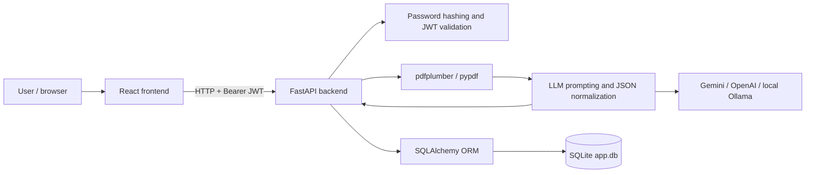
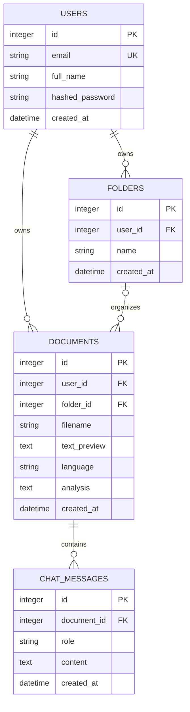
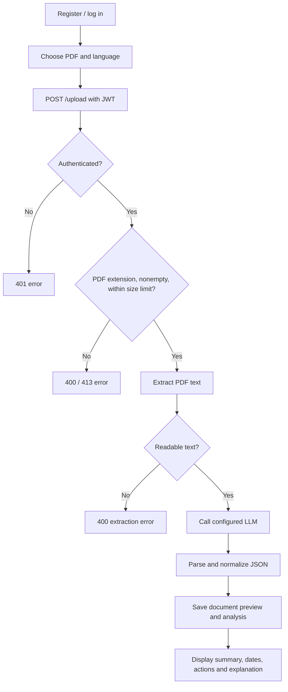
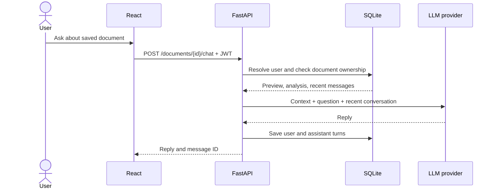

# Design Documentation

## Court Date & Legal Notice Translator

BCS-554, V Semester, 2026–2027. This document describes the implementation present in the repository, not proposed features.

## 1. Objective and scope

Help users understand text-based legal notices by extracting PDF text, identifying key information with an external LLM, displaying simplified explanations, and supporting document-specific questions. The system provides registration, login, private document storage, and folders. It is not a substitute for a lawyer.

## 2. Architecture

The browser uses Axios to call FastAPI. Protected routes resolve the current user from a signed JWT. PDF text is extracted in memory. The backend sends up to 12,000 characters to the configured LLM, normalizes its response, and stores the analysis as JSON text. External AI providers may receive document content; use synthetic or anonymized documents for demonstrations.

## 3. Modules

| Module | Responsibility |
|---|---|
| `frontend/src/App.js` | Authentication gate, upload/document views, dashboard state |
| `frontend/src/components/` | Authentication, upload, folders/documents, results and chat UI |
| `frontend/src/api/api.js` | HTTP requests and token attachment |
| `backend/app/main.py` | API routes, validation, ownership checks and persistence |
| `backend/app/database.py` | SQLAlchemy models, sessions and lightweight migration |
| `backend/app/security.py` | bcrypt password hashing and JWT creation/validation |
| `backend/app/pdf_parser.py` | Text-based PDF extraction and validation |
| `backend/app/llm_processor.py` | Provider dispatch, prompts, parsing, normalization and chat |
| `backend/app/models.py` | API request/response schemas |

## 4. Entity relationship diagram

Each document belongs to one user and optionally one folder. `analysis` is JSON serialized into a text column. `text_preview` stores only the first 500 extracted characters (plus an ellipsis when truncated). The original PDF and full extracted text are not persisted. The ORM deletes a document's messages when the document is deleted. Deleting a folder retains its documents as unfiled. These are application/ORM behaviors, not SQL `ON DELETE CASCADE` guarantees. Older SQLite files receive `folder_id` through an `ALTER TABLE` migration without a foreign-key constraint.

## 5. Upload flow

## 6. Chat sequence

## 7. API summary

Public: `GET /ping`, `POST /auth/register`, `POST /auth/login`.

Protected: `GET /auth/me`; `POST /upload`; `GET /documents`; `GET, DELETE /documents/{id}`; `GET /documents/{id}/messages`; `POST /documents/{id}/chat`; `GET, POST /folders`; `PATCH, DELETE /folders/{id}`; `PUT /documents/{id}/folder`.

Document and folder operations verify ownership. Validation includes PDF extension/signature, empty file, upload size, nonempty folder/chat fields and duplicate email. Interactive API documentation is available at `/docs` while the backend runs.

## 8. Constraints and known limitations

- Scanned/image-only PDFs require OCR, which is not implemented.
- Long notices are truncated for analysis; chat receives only the saved preview and analysis.
- AI output may be inaccurate. Dates and deadlines require comparison with the original notice.
- Malformed AI JSON currently can produce a generic HTTP 500 error.
- Changing the dashboard language does not generate a new translation; select the desired language before upload.
- The development JWT secret must be replaced before deployment.
- Tests mock provider responses: they validate application behavior, not live model quality.

## 9. Evaluation artifacts

- `docs/TEST_CASES.md`: test instructions and scope.
- `docs/TEST_RESULTS.md`: recorded execution results.
- `dataset/README.md`: synthetic data description and evaluation procedure.
- `dataset/expected_results.json`: expected facts for each sample.
- `dataset/pdfs/`: generated text-based sample PDFs.

Mermaid diagrams can be viewed in a Mermaid-capable Markdown viewer or exported using Mermaid Live Editor for a printed report.
